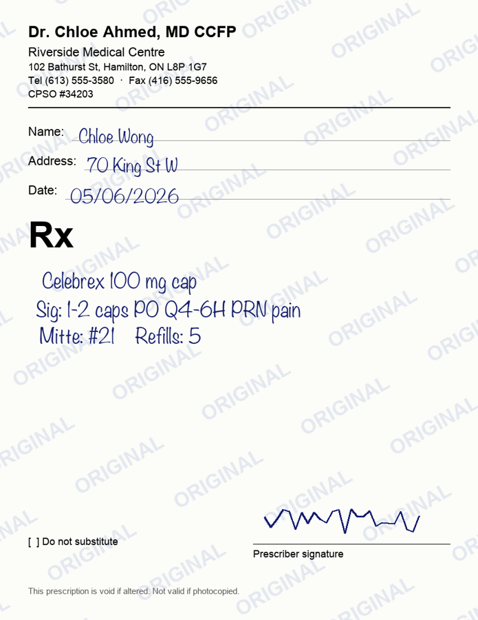
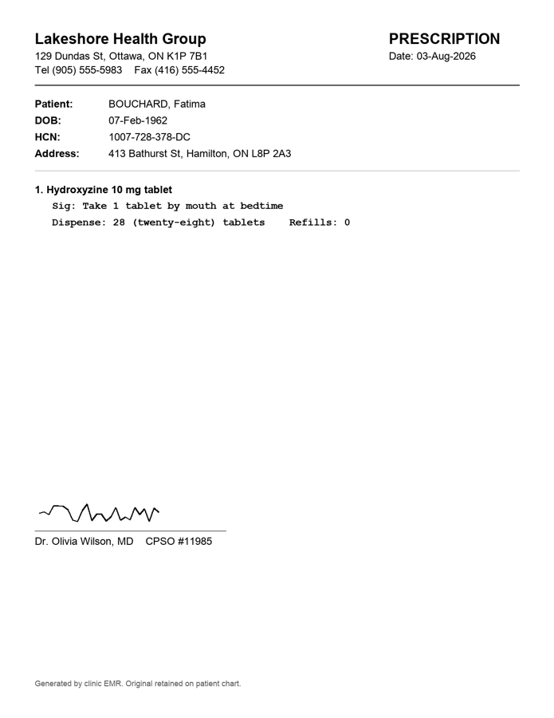
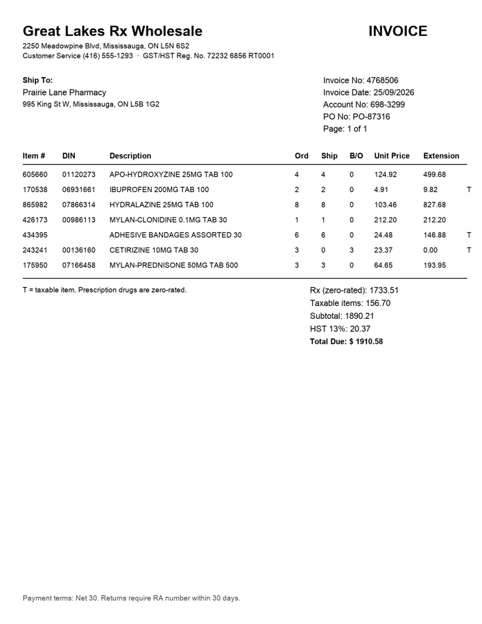
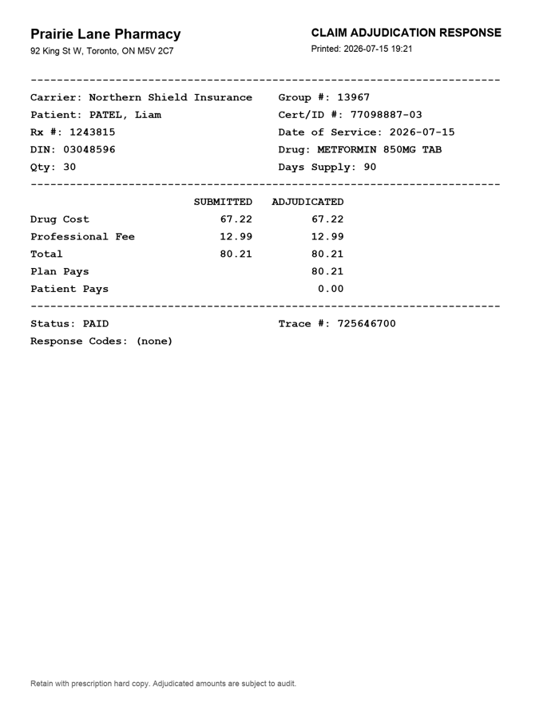

# Pharmacy document extraction: an honest benchmark

A small evaluation harness for the problem in the OneRx AI/ML intern role: reading pharmacy
documents (prescriptions, supplier invoices, claim responses) and turning them into data you
can trust.

| Role asks for | Where it is |
|---|---|
| Build test sets of synthetic documents, including tricky edge cases | [`docbench/generate.py`](docbench/generate.py): Ontario-style Rx pads, EMR printouts, wholesaler invoices, claim adjudication responses, each with a ground-truth JSON label |
| Benchmark OCR and LLM approaches on cost, speed and accuracy | [`docbench/pipelines.py`](docbench/pipelines.py): 5 pipelines (OCR, OCR + reference data, OCR text → LLM, vision LLM, vision LLM + validation), timed and costed per document |
| Evaluation scripts: accuracy per field, error categories, weekly reports | [`docbench/evaluate.py`](docbench/evaluate.py), [`docbench/report.py`](docbench/report.py) → `results/report.md` + `results/history.csv` |
| Curate reference data: drug name variations, prescription directions, templates | [`docbench/reference.py`](docbench/reference.py): generics ↔ Canadian brand names ↔ manufacturer-prefixed generics (`APO-`, `TEVA-`…), look-alike pairs, sig abbreviations, DIN catalogue, claim response codes |
| Write tests, fix bugs, document how things work | [`tests/`](tests/test_docbench.py): 50 tests; this README |
| Cover routine monitoring and run-books | `python -m docbench check` (regression gate, exit 1 on regression) + [`RUNBOOK.md`](RUNBOOK.md) |

**Every number below was measured by running the code in this repo.** Nothing is estimated or simulated.

**See it:** the results come with a visual summary: real specimens, with the page image next to what each pipeline read off it.

- [`web/`](web/) is a **Next.js + TypeScript** app, exported as a static site.
- It includes a **trace** of each specimen (OCR text, the model's raw JSON, every validation check with its reason).
- It includes a **review queue**: every alert raised on all 96 documents, each with the scanned page beside what the model read and what the page actually says.

`.venv/bin/python scripts/export_web_data.py` refreshes the site's data from the latest run. It reads only `results/` and the cached model responses, and never calls an API.

```bash
cd web
npm install
npm run dev              # http://localhost:3000
npm run build            # static site in web/out/ (stop `npm run dev` first: both use .next/)
```

To deploy, import the repo on Vercel with root directory `web`; no settings are needed. For GitHub Pages, build with `BASE_PATH=/<repo-name> npm run build` and publish `web/out/`.

## The documents

<p>




</p>

There are 96 documents (seed 42), 24 of each kind a Canadian independent pharmacy handles:

- **Handwritten Rx pad**: pre-printed prescriber pad with a security watermark. Handwritten Latin shorthand (`1 tab PO BID`, `M: 30`, `Rpt x2`, `No refills`), and the brand name instead of the generic about a third of the time. 1–2 drugs per script.
- **EMR-printed Rx**: `SURNAME, Given`, Ontario health card number, numbered drugs, plain-English directions, `Dispense: 60 (sixty) tablets`. 1–3 drugs per script.
- **Wholesaler invoice**: account and PO numbers. Ordered / shipped / backordered quantities. Manufacturer-prefixed generics (`APO-ATORVASTATIN`). Zero-rated Rx lines mixed with OTC and supply lines that carry 13% HST.
- **Claim adjudication response**: the printout the pharmacy system produces after billing a drug plan. It shows the carrier, group and certificate number, Rx #, DIN, submitted vs. adjudicated amounts, plan pays / patient pays, PAID or REJECTED, and response codes.

Prescription content follows the CPSO [Prescribing Drugs](https://www.cpso.on.ca/Physicians/Policies-Guidance/Policies/Prescribing-Drugs) policy: prescriber name, signature, CPSO number, practice address, patient, drug, strength, quantity, directions, full date and refills.

Claim response codes are limited to ones I could confirm from public sources:

| Code | Meaning |
|---|---|
| D7 | Refill too soon |
| D4 | Refills not covered |
| LO | Benefit maximum exceeded |
| 57 | SSC error |

The full CPhA Pharmacy Claim Standard code table isn't public, so I didn't invent the rest.

**Edge cases built in on purpose:**
- Look-alike drug pairs on the same script, including the classic brand mix-up Celexa (citalopram) / Celebrex (celecoxib)
- Decimal and low doses (`0.5 mg`, `2.5 mg`, `125 mcg`)
- Ambiguous `dd/mm/yyyy` dates
- Fields that are sometimes absent, so I can catch a pipeline that invents them
- Backorders and mixed tax status
- Rejected claims carrying multiple codes

Each document gets one degradation, assigned round-robin: **clean, skew** (2–5°), **blur** (out-of-focus photo), **noise** (speckle + heavy JPEG), **fax** (binarized, streaks, transmission header) or **low_res** (75 dpi scan). I checked by eye that every degraded page is still readable by a person.

All people, clinics, suppliers, insurers, health card numbers and DINs are fictional. Drug and brand names are real. The DINs are random 8-digit numbers, not real Health Canada DINs.

## The pipelines

| Pipeline | What it does | $ cost |
|---|---|---|
| `ocr_regex` | Tesseract → regex parser | free |
| `ocr_reference` | Tesseract on the raw and on a noise-cleaned page, keeping the better parse. Then **repair** with reference data: map generic, brand or `APO-` names to one drug (but refuse when two different drugs are equally close), fix `O→0` / `l→1` in numbers, correct sig words. Finally **validate** (see below). | free |
| `ocr_text_llm` | Tesseract text → LLM (no image), asked to fix obvious OCR character errors but not to guess | tokens |
| `vision_llm` | Page image → LLM, with a JSON-schema-constrained output | tokens |
| `vision_verified` | `vision_llm`'s answer + the same **validation**, flag-only. No values are changed, and no extra API call is made. | same as `vision_llm` |

**Validation** ([`validate()` in `docbench/pipelines.py`](docbench/pipelines.py)) runs the checks a pharmacist or bookkeeper would do by hand, and flags anything that fails for human review:

- **Drugs:** the drug is in the reference list, the strength is a marketed one, and every sig word is a dose or a known direction word.
- **Invoices:** DINs are in the catalogue; `shipped × unit = extension`; the lines add up to the subtotal; HST = 13% of taxable lines; total = subtotal + HST.
- **Claims:** plan share + patient share = submitted total; a rejected claim pays $0 and carries a known response code.

The LLM code supports both **OpenAI** and **Claude** models (`--model gpt-5.4-nano`, `--model claude-haiku-5-5`, …), with the same prompt and schema.

## Results (96 documents, LLM = `gpt-5.4-nano`, reasoning effort `low`)

| Pipeline | Field accuracy | Critical-field accuracy | Critical silent errors | p50 latency | Cost / 1K docs |
|---|---|---|---|---|---|
| `ocr_regex` | 50.9% | 46.9% | 40 | 425 ms | $0.00 |
| `ocr_reference` | 65.8% | 61.8% | 7 | 921 ms | $0.00 |
| `ocr_text_llm` | 62.8% | 65.0% | 159 | 3.7 s | $0.79 |
| `vision_llm` | 91.9% | 92.9% | 60 | 4.1 s | $1.16 |
| **`vision_verified`** | **91.9%** | **92.9%** | **6** | 4.1 s | $1.16 |

| Accuracy by degradation | clean | skew | blur | noise | fax | low_res |
|---|---|---|---|---|---|---|
| `ocr_regex` | 91.4% | 77.6% | 43.2% | 1.8% | 25.2% | 64.9% |
| `ocr_reference` | 93.5% | 81.8% | 45.8% | 60.7% | 32.2% | 81.3% |
| `ocr_text_llm` | 86.4% | 86.2% | 65.4% | 14.4% | 41.7% | 88.0% |
| `vision_llm` / `vision_verified` | 97.6% | 95.0% | 92.0% | 95.7% | 71.8% | 97.7% |

| Accuracy by style | Handwritten Rx pad | EMR-printed Rx | Wholesaler invoice | Claim response |
|---|---|---|---|---|
| `ocr_regex` | 36.2% | 70.6% | 38.0% | 71.0% |
| `ocr_reference` | 55.4% | 88.6% | 48.7% | 89.5% |
| `ocr_text_llm` | 60.1% | 84.3% | 49.0% | 77.2% |
| `vision_llm` / `vision_verified` | 85.1% | 93.9% | 94.0% | 89.5% |

**Critical fields** are drug, strength, sig, quantity, DIN, quantity shipped, unit cost, line total, invoice total, claim status, plan pays, patient pays and response codes.

A **critical silent error** is a filled-in critical value that is wrong and carries no review flag. Blank fields don't count, because a reviewer can see a blank but can't see a plausible wrong number. This is the metric I care most about in healthcare.

A full run of both LLM pipelines over the 96 documents costs about **$0.19**. Validation adds no API cost.

The full report with per-field accuracy, error categories and example errors is in [`results/report.md`](results/report.md).

### What I learned

1. **Accuracy alone is the wrong headline.** Vision LLM is far more accurate than OCR with reference data (91.9% vs. 65.8%). But on its own it leaves **60 critical values wrong with no warning, against 7 for OCR**. When OCR can't read something it leaves a blank. When an LLM can't read something it often returns a confident, plausible wrong value.
2. **Cheap validation fixes most of that.** Running the reference checks over the LLM's output caught **54 of its 60 critical wrong values (90%)**. That gives LLM-level accuracy with fewer silent errors than either approach alone, at $0 extra.
   - The cost is review load: 32 of 96 documents get at least one flag.
   - 28 of the 98 flags were false alarms.
3. **The 6 errors that still get through** are the ones no rule can catch, because the wrong value is also a valid one:
   - `1-2 caps` read as `12 caps`
   - `1-2 tabs` read as `1/2 tabs`
   - `Qty 60` read as `30` on a faxed claim
   - a unit price misread on a backordered line, where 0 × any price is still $0.00

   These need a second reader (e.g. OCR vs. LLM disagreement) or a human.
4. **Never feed garbage OCR text to an LLM.** On noisy and faxed pages, `ocr_text_llm` *invented* values that aren't on the page, whole invoice lines included (65 `hallucinated` fields), and had the most silent errors of any pipeline (159). It also read pack sizes ("TAB 30") as order quantities: 4.3% accuracy on `qty_ordered`, vs. 98.6% for vision.
5. **Fax is the hardest input for every pipeline** (72% at best). Handwritten pads are next: 55% for OCR, 85% for vision. A clean-PDF benchmark would badly overstate production accuracy.
6. **Reference data pays for itself even without an LLM.** It lifted OCR drug-name accuracy from 74% to 94% on EMR scripts and from 63% to 84% on pads, mostly by knowing that `Lipitor`, `APO-ATORVASTATIN` and `Atorvastatin` are the same drug.

### Checking the test itself

An earlier version of the test set printed claims and EMR directions in a hairline Courier face. A fax wiped it out completely, so those pages were unreadable to a person too, which made the test unfair to every pipeline. I caught it by laying out all 24 style × condition combinations side by side and reading each one. The printouts now use the bold cut, as real laser and thermal printouts effectively do, and every number above is from the corrected set.

## Run it

```bash
brew install tesseract                     # or apt-get install tesseract-ocr
python -m venv .venv && .venv/bin/pip install -r requirements.txt
.venv/bin/python -m docbench generate      # 96 docs → data/docs, ground truth → data/ground_truth
.venv/bin/python -m docbench run --pipelines ocr_regex,ocr_reference    # free, no API key
.venv/bin/python -m docbench check         # exit 0 healthy, 1 regression, 2 no baseline yet
.venv/bin/python -m pytest -q tests
```

With an LLM (OpenAI or Claude), all five pipelines:

```bash
export OPENAI_API_KEY=...                  # or ANTHROPIC_API_KEY for claude-* models
.venv/bin/python -m docbench run --model gpt-5.4-nano --max-cost 0.50
```

- `--max-cost` is a hard spend cap in USD (default $1.00). LLM calls stop before it is crossed.
- `--limit N` runs on N documents sampled across every style and degradation, for cheap smoke tests.
- Every LLM response is cached in `results/llm_cache/`, so re-runs and `vision_verified` cost nothing extra.
- `python -m docbench rescore` re-scores the saved predictions after a scoring change, also at no cost.

Every run:
- rewrites `results/report.md`
- appends a row per pipeline to `results/history.csv`, tagged with a fingerprint of the test set
- archives its predictions to `results/archive/`

`check` compares each pipeline with its previous run on the same test set and model. It fails on a drop in critical accuracy, a rise in silent errors, latency or cost, or any failed document. [`RUNBOOK.md`](RUNBOOK.md) says what to do when it fails.

## How scoring works

- **Values are normalized before comparison**, so formatting is not an error. These all count as matches:
  - `500mg` = `500 mg`
  - `14-Mar-2026` = `14/03/2026` = `2026-03-14`
  - `KHAN, Mei` = `Mei Khan`
  - `$1,234.50` = `1234.50`
  - `Lipitor` = `APO-ATORVASTATIN` = `Atorvastatin`
  - `LO, D7` = `D7,LO`

  Misspellings are never forgiven: `Ce1exa` is still wrong.
- **Medications and invoice lines are aligned by content, not position.** One missed row costs that row only, instead of shifting every row after it.
- **Fields absent from the page and correctly left blank are not scored**, so they can't pad accuracy. A value returned for an absent field is scored as `hallucinated`.
- **Error categories:**

  | Category | Meaning |
  |---|---|
  | `missing` | Field is on the page but nothing was returned |
  | `numeric_mismatch` | Wrong number: dose, quantity, price, ID or response code |
  | `date_mismatch` | Wrong date |
  | `near_miss` | Text off by a few characters |
  | `wrong_value` | Anything else, e.g. a look-alike drug or the wrong claim status |
  | `hallucinated` | Value returned for a field that isn't on the page |

## Limitations (please read)

- **Synthetic data.** The documents are realistic in layout and content, but the handwriting is a font and the degradations are simulated. Real faxes, phone photos and doctors' handwriting will be harder. The next step would be a small de-identified set labelled with a pharmacist, as the role describes.
- **The regex parsers know my templates.** That makes the OCR baselines optimistic on clean pages. On an unseen layout they would need new rules, a maintenance cost the LLM pipelines don't have.
- **Claim response codes are a confirmed subset**, not the full CPhA table. Real responses also carry informational codes on paid claims, which aren't modelled here.
- **Clinical notes aren't covered yet.** They are the fourth document type in the role, and free text needs a different evaluation (entity-level matching rather than fixed fields).
- **Small sample, one LLM run.** With 96 documents (4 per style × degradation), differences of a few points are noise. LLM output also varies from run to run. Treat the big gaps as real and the small ones as not.
- **One small model.** The LLM numbers are for `gpt-5.4-nano` at low reasoning effort, the cheapest capable option. Larger models will likely do better on fax and handwriting, at roughly 4–25× the price per token. The harness runs them unchanged.

## Next steps I'd want to try

- **Two-reader disagreement:** compare the OCR and vision readings field by field and flag where they disagree. This targets the 6 errors validation can't catch (`12` vs. `1-2`).
- **Cascade:** run `ocr_reference` first and only send flagged documents to the vision LLM. Then measure cost and silent errors against vision-only.
- **Model sweep:** `gpt-5.4-mini`, a Claude model, and a local model, on the same test set, to see whether a bigger model is worth its price after validation.
- **Clinical notes** with entity-level scoring (drugs, doses, allergies, conditions).
